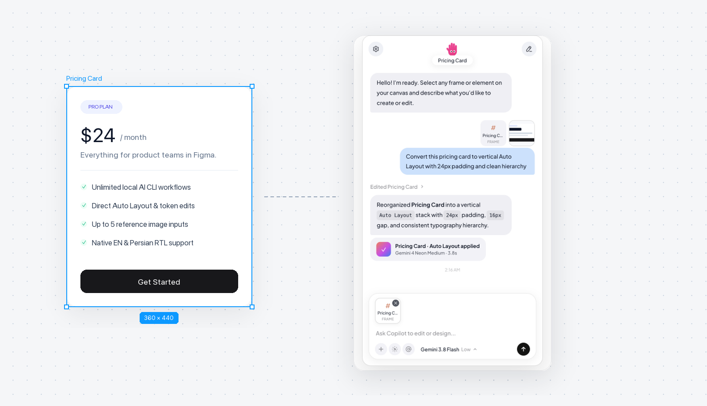
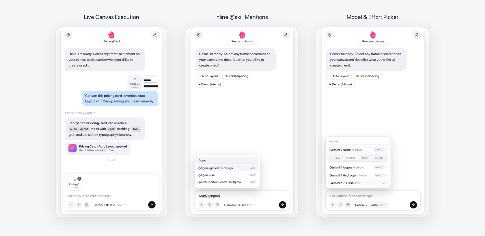
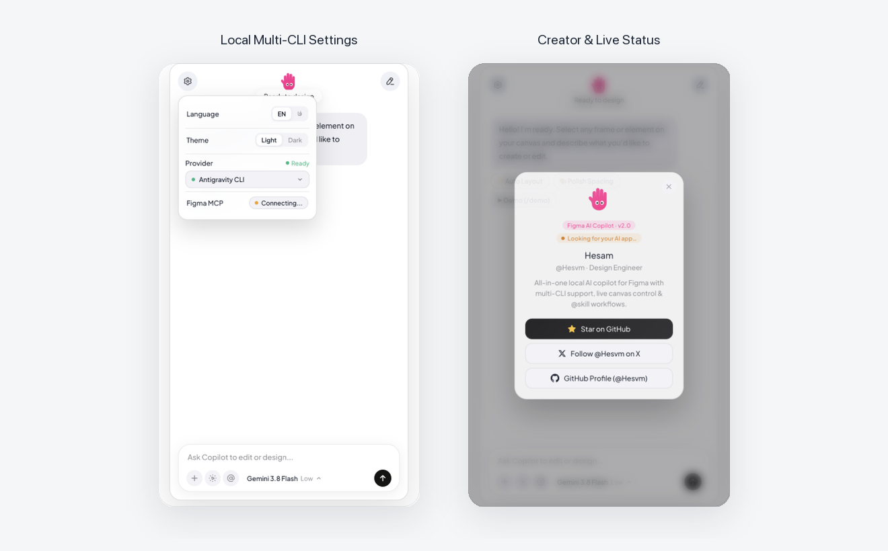

# Figma AI Copilot (All-in-One)

<p align="center">
  
</p>

**Local-first AI Copilot for Figma Desktop — zero API keys required.**  
Connect Figma directly to your local AI CLIs (**Antigravity**, **Claude Code**, **Cursor Agent**, **Codex**, **Gemini CLI**, **Ollama**, or any **Custom CLI**) with live canvas execution, `@skill` mentions, multi-image paste, and full English & Persian (RTL) support.

---

## Interface Gallery

<p align="center">
  
</p>

<p align="center">
  
</p>

<p align="center">
  
</p>

---

## Features

- **Zero API Keys, Local CLI Bridge** — Auto-detects installed CLIs (`agy`, `claude`, `cursor-agent`, `codex`, `gemini`, `ollama`) on `http://localhost:9444`.
- **Direct Live Canvas Execution** — Inspects selected Figma frames/components (Auto Layout, typography, fills, padding, children) and executes async Figma Plugin API scripts directly on your canvas.
- **Streaming Activity & Shimmer UI** — Real-time NDJSON streaming with collapsible step logs, elapsed timer, luminous shimmer states, and live Stop/Cancel control.
- **Inline `@skill` Mentions** — Type `@` in the prompt box to autocomplete from your installed `SKILL.md` workflows and inject them into your prompt.
- **Up to 5 Reference Attachments** — Paste screenshots directly with `Cmd+V` / `Ctrl+V` or attach up to 5 images alongside your selected Figma frame.
- **Cursor Pick Mode & Starter Chips** — Click the cursor icon to attach any layer on canvas, or start in one click with localized starter prompt chips.
- **Bilingual EN / فارسی (RTL) + Light & Warm Dark Themes** — Native `Plus Jakarta Sans` + `IRANYekanX` typography with proper RTL/LTR bidi isolation and frosted-glass macOS spring menus.

---

## Quick Start (2 Steps)

### 1. Start the Local CLI Bridge
Run the included installer (macOS LaunchAgent) or start the daemon manually:

```bash
# Option A: Install as a background LaunchAgent (auto-starts on login)
bash bridge/install-bridge.sh

# Option B: Run manually in terminal
python3 bridge/bridge_daemon.py
```

The bridge listens on `http://localhost:9444` and automatically discovers your installed AI CLIs and `@skills`.

### 2. Load the Plugin in Figma Desktop
1. Open **Figma Desktop**.
2. Go to **Plugins → Development → Import plugin from manifest...**
3. Select `manifest.json` from this repository.
4. Run **Figma AI Copilot (All-in-One)** (`Cmd + Option + P` to re-run anytime).

> **Tip:** Type `/demo` in the plugin input (or click **Demo (/demo)**) to preview the showcase stream, activity logs, and error/success cards.

---

## Architecture

```
Figma Desktop Canvas
   │
   ▼  (Selection tree + async Plugin API execution)
code.js  ◄── postMessage ──►  ui.html (Copilot UI + Light/Dark + EN/FA)
                                  │
                                  ▼  http://localhost:9444
                        bridge/bridge_daemon.py
                                  │
                                  ▼  subprocess / stream-json
              agy · claude · cursor-agent · codex · gemini · ollama
```

---

## Project Structure

- `manifest.json` — Figma plugin manifest (`dynamic-page` access + localhost bridge domains)
- `code.js` — Figma sandbox runner & selection serializer
- `ui.html` — Self-contained Copilot UI, Settings, Model/Effort picker, `@skill` mentions & Themes
- `bridge/bridge_daemon.py` — Local HTTP bridge server (`:9444`) with CLI auto-detection & streaming
- `bridge/install-bridge.sh` — macOS LaunchAgent installer

---

## Author

Built by **Hesam** ([@Hesvm](https://github.com/Hesvm)) · [X / Twitter](https://x.com/Hesvm)

If this saved you time, consider giving the repo a ⭐!
