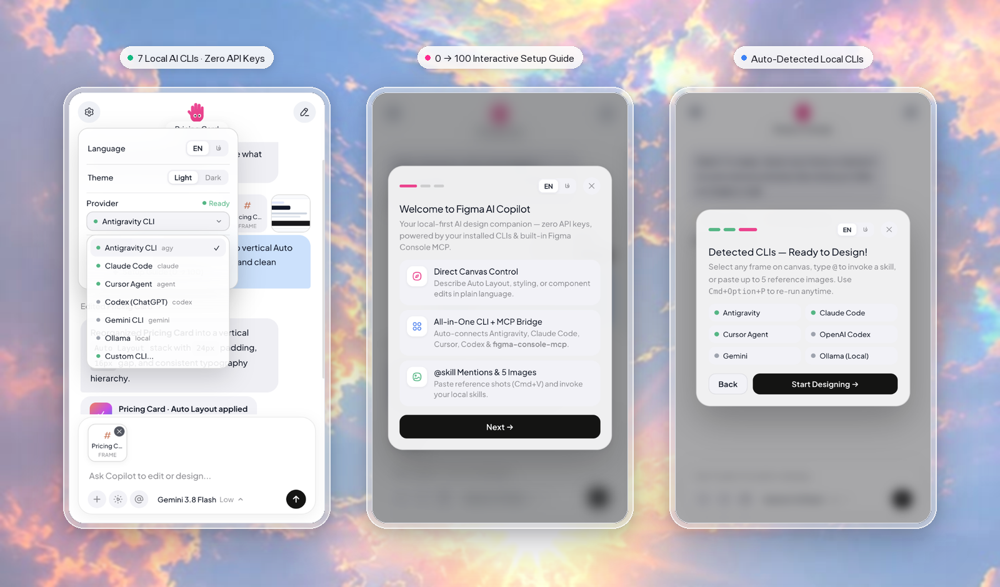

# Figma AI Copilot (All-in-One)

<p align="center">
  
</p>

**Figma AI Copilot** is an open-source, local-first Figma Desktop plugin and full [southleft/figma-console-mcp](https://github.com/southleft/figma-console-mcp) bridge that connects Figma directly to **Antigravity (`agy`)**, **Claude Code (`claude`)**, **OpenAI Codex / ChatGPT (`codex`)**, **Cursor Agent (`agent`)**, **Gemini CLI (`gemini`)**, and **Ollama** — with **zero API keys required**.

> **Bottom Line:** Install one plugin in Figma Desktop and run `bash bridge/install-bridge.sh`. You immediately get both an in-Figma AI chat copilot (with `@skill` mentions, up to 5 pasted screenshots, and EN/Persian RTL support) and a fully wired `figma-console-mcp` WebSocket bridge (`9223–9232`) for Claude Desktop, Cursor, and Antigravity.

---

## Comparison: Figma AI Copilot vs. Alternatives

| Feature | **Figma AI Copilot (All-in-One)** | Standalone `figma-console-mcp` | Cloud-Only Figma AI Plugins |
| --- | --- | --- | --- |
| **API Keys Required** | **None (`$0` extra)** — uses your local CLIs | External MCP client only | Paid API keys / per-seat SaaS |
| **In-Figma Chat UI** | **Yes** (Streaming, Shimmer, Stop, Starter Chips) | No (external chat only) | Yes |
| **Supported AI CLIs** | **7** (`agy`, `claude`, `codex`, `cursor`, `gemini`, `ollama`, `custom`) | MCP-compatible hosts | Proprietary backend |
| **`figma-console-mcp` Tools (56+)** | **Built-in** + auto-configured by installer | Yes | No |
| **Posts, Carousels, UI/UX, Tokens, Slides** | **Full Plugin API + MCP** | Via external client | Limited templates |
| **Inline `@skill` Mentions & 5 Images (`Cmd+V`)** | **Yes** | Host-dependent | Rare |
| **Native Persian (RTL) + Light/Dark Themes** | **Yes** (`IRANYekanX` + `Plus Jakarta Sans`) | No | No |
| **Interactive 0 → 100 Onboarding** | **Built-in 3-step wizard** | Manual JSON setup | Account signup |

---

## Why This Exists

- **Zero API Keys, Zero Extra Cost** — Uses your existing local AI CLI subscriptions or local Ollama models via `http://localhost:9444`.
- **All of `figma-console-mcp` Built In** — Includes the full Figma Desktop Bridge WebSocket runner in [`code.js`](code.js) & [`ui.html`](ui.html), and [`bridge/install-bridge.sh`](bridge/install-bridge.sh) automatically configures `figma-console-mcp` for Claude Desktop, Cursor, and Antigravity — so you don't need to install or maintain a second Figma plugin.
- **Interactive 0 → 100 Onboarding Inside Figma** — First-time users get an interactive 3-step setup wizard inside the plugin with live bridge detection, 1-click command copy, and auto-detected CLI status.
- **Built for Real Design Workflows** — Live streaming progress, collapsible activity logs, `@skill` workflow mentions, up to 5 pasted reference screenshots (`Cmd+V`), and native **English & Persian (RTL)** typography.

---

## Interface Gallery

<p align="center">
  
</p>

<p align="center">
  
</p>

<p align="center">
  
</p>

---

## What You Can Build in Figma

Because the Copilot runs full async Figma Plugin API scripts + `figma-console-mcp` tools directly on your canvas, it handles **anything you'd normally build in Figma**:

- **Social Media Posts & Carousels** — Generate 1080×1350 Instagram carousels, LinkedIn visual posts, YouTube thumbnails, and promo banners from a prompt or reference image.
- **UI/UX Screens & Components** — Design landing page sections, mobile app screens, dashboards, modals, and clean responsive Auto Layout components.
- **Design Systems & Tokens** — Create and update Variables, color/spacing collections, Light/Dark mode themes, typography styles, and multi-variant Component Sets.
- **FigJam Boards & Figma Slides** — Generate architecture flowcharts, sticky-note brainstorms, comparison tables, and multi-slide presentation decks.
- **Reference-to-Figma & Audits** — Paste up to 5 screenshots (`Cmd+V`) to match a layout style, fix contrast/hierarchy issues, or convert English layouts into native **Persian (RTL)**.

---

## Key Capabilities

### 1. Direct Canvas AI Copilot
- **Live Async Execution (`code.js`)** — Reads your selected frame tree (Auto Layout, padding, spacing, fills, corner radius, typography, children) and executes Figma Plugin API scripts (`dynamic-page` compliant) directly on your canvas.
- **Streaming & Shimmer Activity** — Real-time NDJSON streaming with elapsed timer, luminous shimmer indicators, collapsible step logs (`Analyzed`, `Loaded`, `Thinking`, `Edited`), and instant **Stop (`■`)** cancellation.
- **Inline `@skill` Mentions** — Type `@` in the prompt box to search and inject your local `SKILL.md` workflows (`~/.gemini/config/skills`, `~/.claude/skills`, `~/.cursor/skills`, `~/.agents/skills`).
- **Up to 5 Reference Images** — Paste screenshots directly with `Cmd+V` / `Ctrl+V` or pick multiple images alongside your selected Figma frame.
- **Cursor Pick Mode & Starter Chips** — Click the cursor icon to attach any layer on canvas, or test workflows immediately with localized Starter Chips.

### 2. Full `southleft/figma-console-mcp` Compatibility
Running this plugin automatically opens the Desktop Bridge WebSocket client (`9223–9232`) so any MCP-capable client (Claude Desktop, Cursor, Antigravity, Claude Code) gets full access to:
- **Design Systems & Variables** — Inspect/create/update variables, collections, modes, styles, and component sets.
- **Live Canvas & Execution** — Run arbitrary Plugin API code (`figma_execute`), capture live canvas screenshots (`figma_capture_screenshot`), inspect real-time plugin console logs, and audit accessibility/parity.
- **FigJam & Figma Slides** — Create stickies, connectors, tables, diagrams, slides, and transitions.

### 3. Supported Local AI Providers (Zero API Keys)

<p align="center">
  
</p>

The local bridge automatically scans your `PATH` and shows a green **Ready** indicator for every AI CLI installed on your machine — switch between them anytime from **Settings → Provider**:

| Provider | CLI Binary | Best For & Notes |
| --- | --- | --- |
| **Antigravity CLI** | `agy` | Live `stream-json` token & step streaming + Effort picker (`Low` / `Medium` / `High` / `XHigh`) |
| **Claude Code CLI** | `claude` | Anthropic Claude models directly via your Claude Code CLI subscription with `@skill` context |
| **Cursor Agent CLI** | `cursor-agent` / `agent` | Cursor's headless agent CLI auto-detected from PATH |
| **OpenAI Codex (ChatGPT)** | `codex` | OpenAI / ChatGPT Codex CLI (`codex exec`) using your local ChatGPT/Codex auth |
| **Gemini CLI** | `gemini` | Google Gemini CLI (`gemini -p`) |
| **Ollama (Local)** | `ollama` | 100% offline local open-weights models |
| **Custom CLI** | Any binary/script | Run any custom command template (`my-cli -p {prompt}`) |

---

## 0 → 100 Setup Guide

### Prerequisites
- **Figma Desktop** (macOS / Windows / Linux)
- **Python 3.9+** (pre-installed on macOS)
- At least one supported AI CLI (`agy`, `claude`, `cursor-agent`, `codex`, `gemini`, or `ollama`)
- *(Optional)* **Node.js 18+** if you want external MCP clients (`Claude Desktop`, `Cursor`, `Antigravity`) to also connect via `figma-console-mcp`

### Step 1 — Clone the Repository
```bash
git clone https://github.com/Hesvm/figma-ai-copilot.git
cd figma-ai-copilot
```

### Step 2 — Run the 1-Click All-in-One Installer
```bash
bash bridge/install-bridge.sh
```
This script automatically:
1. Starts the **Local CLI Bridge** on `http://localhost:9444` (and installs a macOS LaunchAgent so it auto-starts on login).
2. Auto-detects **Claude Desktop**, **Cursor**, and **Antigravity** configs and wires **`figma-console-mcp`** (`npx -y figma-console-mcp@latest`) if not already configured — zero manual JSON editing required.

*(Prefer running manually without LaunchAgent? Run `python3 bridge/bridge_daemon.py`.)*

### Step 3 — Import the Plugin in Figma Desktop
1. Open **Figma Desktop**.
2. Go to **Plugins → Development → Import plugin from manifest...**
3. Select `manifest.json` from the cloned `figma-ai-copilot` folder.
4. Launch **Figma AI Copilot (All-in-One)** (`Cmd + Option + P` anytime to re-run).

### Step 4 — Interactive Onboarding
On first launch, the plugin opens a 3-step **Interactive Setup Wizard** (`EN / فا`) that verifies your local bridge connection live, lists all detected AI CLIs on your machine, and gets you designing in seconds. You can re-open it anytime from **Settings → Setup Guide (0 → 100)**.

---

## Architecture

```
Figma Desktop Canvas
   │
   ▼  (Selection tree + async Plugin API execution)
code.js  ◄── postMessage ──►  ui.html (Copilot UI + Onboarding + EN/FA RTL)
   │                             │
   │  ws://localhost:9223-9232   │  http://localhost:9444
   ▼                             ▼
figma-console-mcp        bridge/bridge_daemon.py
(External MCP Clients)           │
                                 ▼  subprocess / stream-json
                    agy · claude · cursor · codex · gemini · ollama
```

---

## Frequently Asked Questions (FAQ)

### How do I use Claude Code, ChatGPT Codex, Cursor, or Antigravity inside Figma without an API key?
Install **Figma AI Copilot** via `manifest.json` and run `bash bridge/install-bridge.sh`. The local bridge (`http://localhost:9444`) automatically detects your installed CLIs (`agy`, `claude`, `codex`, `cursor-agent`, `gemini`, `ollama`) and executes their generated Figma Plugin API scripts directly on your canvas using your existing CLI logins.

### Does this replace or include `southleft/figma-console-mcp`?
Yes. Both [`code.js`](code.js) and [`ui.html`](ui.html) bundle the complete Figma Desktop Bridge WebSocket client (`9223–9232`), and `bash bridge/install-bridge.sh` automatically registers `npx -y figma-console-mcp@latest` in Claude Desktop, Cursor, and Antigravity so you never need a second plugin or manual JSON setup.

### What can I design with Figma AI Copilot?
Anything you normally build in Figma: Instagram 1080×1350 carousels, LinkedIn posts, YouTube thumbnails, landing pages, mobile app screens, responsive Auto Layout components, Figma Variables & design tokens, FigJam flowcharts, and Figma Slides.

### Does it work offline and in Persian (RTL)?
Yes. Select **Ollama** in Settings for 100% offline local models, and switch Language to **فا (Persian)** for full RTL layout, bidi-isolated code/numbers, and native **IRANYekanX** typography.

---

## Troubleshooting

- **Bridge shows `Offline` in Settings:** Run `bash bridge/install-bridge.sh` (or check `curl http://localhost:9444/status`).
- **`figma-console-mcp` not connecting from Claude/Cursor:** Make sure the plugin window is open in Figma Desktop (that opens the WebSocket bridge on ports `9223–9232`) and restart your MCP client once after running `install-bridge.sh`.
- **Quick UI Preview without Figma:** Type `/demo` in the plugin input, or serve the folder locally (`python3 -m http.server 8765`) and open `http://localhost:8765/ui.html?showcase=en` or `?showcase=fa`.

---

## Author & License

Built by **Hesam** ([@Hesvm](https://github.com/Hesvm)) · [X / Twitter](https://x.com/Hesvm)  
Licensed under the [MIT License](LICENSE). If this saved you time, consider giving the repo a ⭐!
